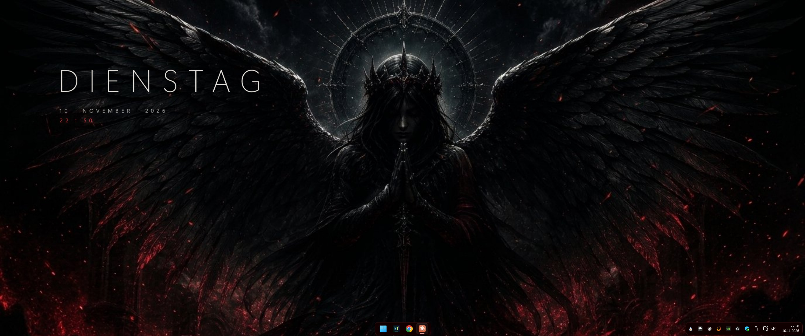
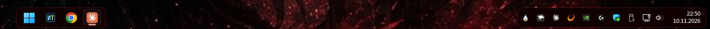
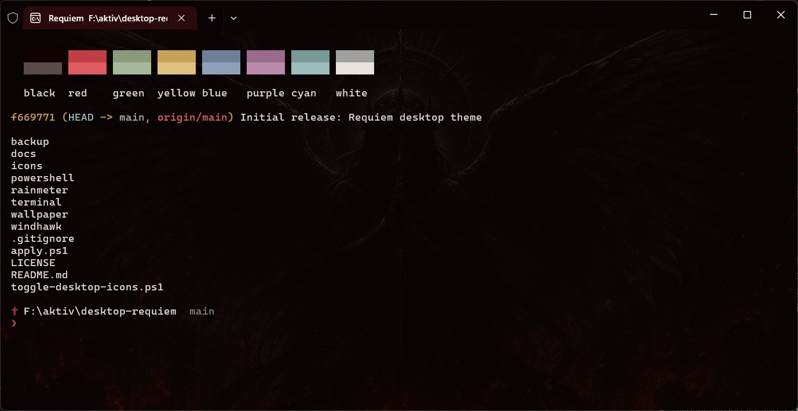

# Requiem

A minimal gothic Windows 11 desktop theme in ember red and halo silver: a spaced weekday clock, a floating tinted dock, a matching Windows Terminal scheme and a PowerShell prompt. Every color is sampled from the included wallpaper.



## Screenshots

**Floating dock and tray** (Windhawk Taskbar Styler, `DockLike` + Requiem overrides)



**Windows Terminal** with the "Blackwell Requiem" scheme, faint wallpaper and the Requiem prompt (`terminal/palette-demo.ps1` prints the swatches)



## Components

| Part | Tool | Source |
| :--- | :--- | :--- |
| Weekday / date / time | [Rainmeter](https://www.rainmeter.net/) 4.5+ | `rainmeter/Requiem/Requiem.ini`, layout `rainmeter/Layouts/Requiem/Rainmeter.ini` |
| Floating dock and tray | [Windhawk](https://windhawk.net/) + mod *Windows 11 Taskbar Styler*, theme `DockLike` with Requiem overrides | `windhawk/taskbar-styler-requiem.yaml` |
| Windows Terminal | color scheme + tab theme "Blackwell Requiem", acrylic, faint wallpaper | `terminal/blackwell-requiem.json`, `terminal/palette-demo.ps1` |
| PowerShell prompt | Windows PowerShell 5.1, no extra modules | `powershell/requiem-prompt.ps1` |
| Tab / profile icon | halo + ember cross, generated | `icons/requiem.png`, `icons/make-icon.ps1` |
| Wallpaper | 1376×768 | `wallpaper/requiem-desktop.jpg` |

## Palette

| Role | Hex |
| :--- | :--- |
| Void | `#000000` |
| Surface | `#100000` / `#200000` |
| Ember dark / mid / hot | `#801115` / `#8E1C21` / `#C03E45` |
| Halo silver | `#7F7E7C` / `#A0A09E` |
| Windows accent color | `#8E1C21` |

## Install

Requirements: Windows 11, Rainmeter, Windhawk.

```powershell
winget install --id Rainmeter.Rainmeter --exact
winget install --id RamenSoftware.Windhawk --exact
```

1. **Rainmeter clock** – pick one:
   - **Package (easiest):** download `Requiem_<version>.rmskin` from [Releases](https://github.com/Blackwellcode/requiem-desktop/releases) and double-click it. Keep *Apply included layout* checked; it loads the clock at the default position and unloads other active skins (Rainmeter backs up replaced files to `Skins\@Backup`).
   - **Script (also hides desktop icons and adds autostart):**
     ```powershell
     .\apply.ps1                        # deploy skin, set layout, autostart, hide desktop icons
     .\apply.ps1 -X 10% -Y 20%          # move the clock (percent of the screen, or pixels)
     .\apply.ps1 -KeepOtherSkins        # leave your other Rainmeter skins loaded
     .\apply.ps1 -NoAutostart -SkipExplorer
     ```
     `apply.ps1` finds Rainmeter via the registry, reads the skin folder from `Rainmeter.ini`, and backs that file up to `Rainmeter.ini.requiem-<timestamp>.bak` before changing it.

   The winget install of Rainmeter adds no autostart entry. `apply.ps1` creates a shortcut in your Startup folder; with the package, add one yourself (`shell:startup`) or the clock is gone after a reboot.

   The clock scales with the screen height and follows the Windows scaling level, and weekday/month names follow your Windows date format (`FormatLocale=Local`).
2. **Dock** – in Windhawk install *Windows 11 Taskbar Styler*, open *Settings > Text mode*, paste `windhawk/taskbar-styler-requiem.yaml`, save. Turn on Windows *Transparency effects* for the acrylic look.
3. **Terminal** – merge `terminal/blackwell-requiem.json` into Windows Terminal's `settings.json` (instructions inside the file).
4. **Prompt** – add to `$PROFILE`:
   ```powershell
   . '<path-to-repo>\powershell\requiem-prompt.ps1'
   ```
   Cross is ember when the session is elevated, silver otherwise; the arrow turns light red after a failed command.
5. **Accent color** – *Settings > Personalization > Colors > Custom colors*: `#8E1C21`.

## Revert

```powershell
.\toggle-desktop-icons.ps1 -Show   # show desktop icons again
```

- Dock: Windhawk > Windows 11 Taskbar Styler > Disable.
- Rainmeter: unload the *Requiem* skin or reactivate your previous skins.

## Build the package

```powershell
.\build.ps1   # -> dist\Requiem_<version>.rmskin (version from [Metadata] in Requiem.ini)
```

An `.rmskin` is a zip archive with a 16-byte footer: the zip length as unsigned 64-bit little-endian, then `00 52 4D 53 4B 49 4E 00` ("RMSKIN"). Text files inside are UTF-16 LE.

## Notes

- Windhawk mods can break after Windows feature updates; disable or update the mod if the taskbar misbehaves.
- The wallpaper is 1376×768 and is upscaled on high-resolution and ultrawide monitors.

## License

Code and configuration: [MIT](LICENSE). The wallpaper (`wallpaper/`) and icon artwork are © Blackwellcode and not covered by the MIT license.
